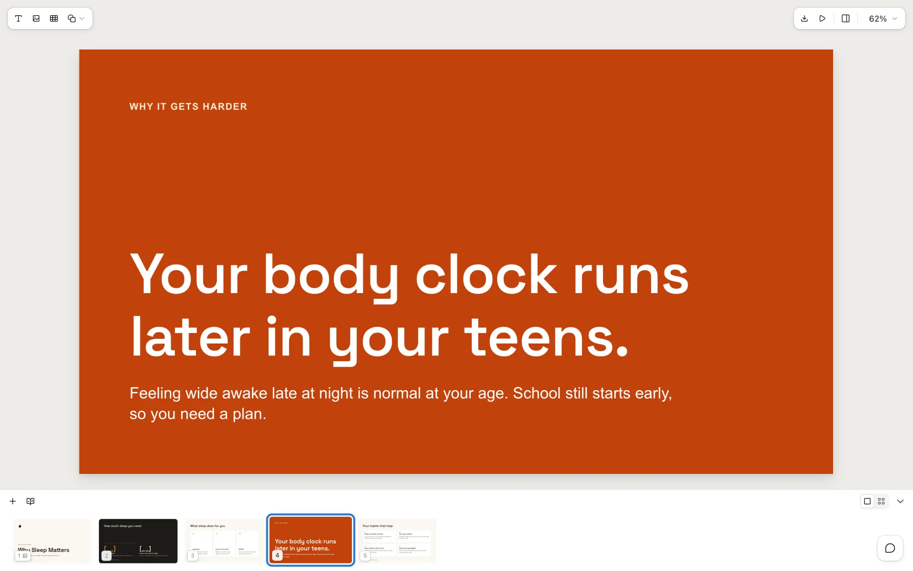
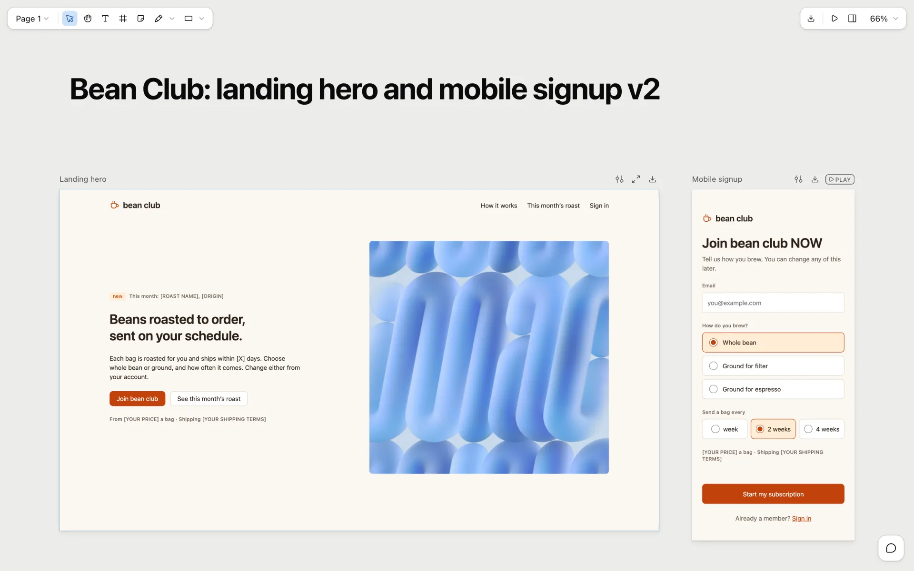
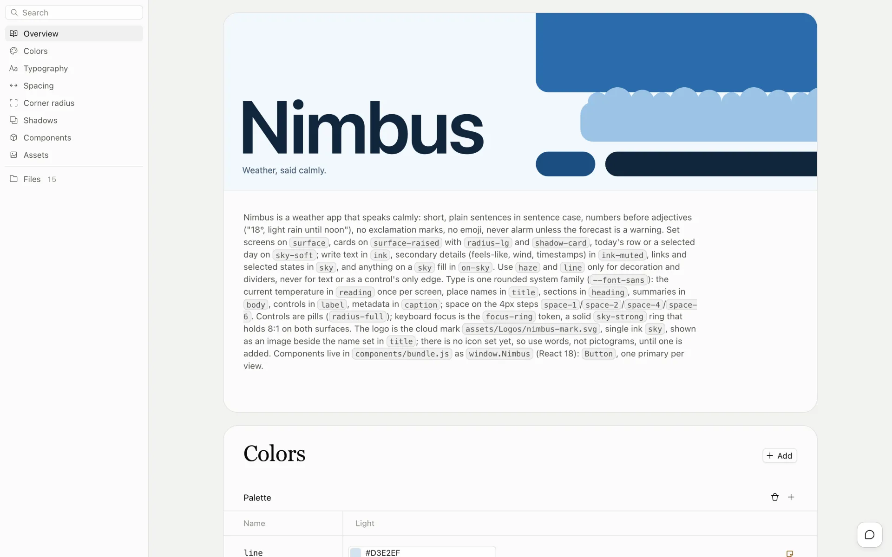
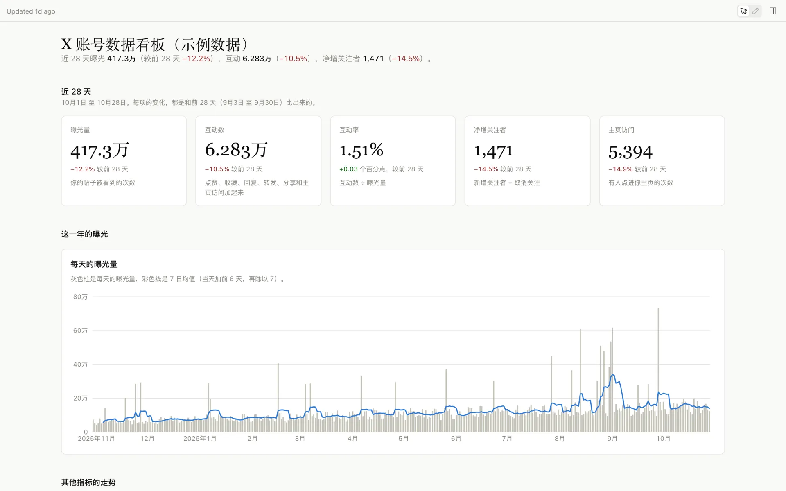
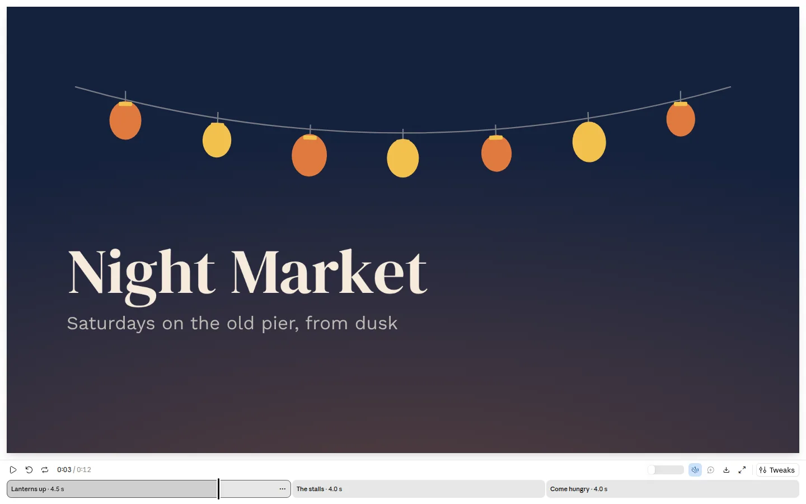

# libre-artifacts

**Editable slide decks, design canvases, design systems, dashboards and motion films for your own local agent — Cursor, Claude Code, Codex, or any file‑capable coding agent.**

[English](README.md) · [简体中文](README.zh-CN.md) · [Changelog](CHANGELOG.md)

[](NOTICE.md)  

This repo brings claude.ai's **Artifact types** to local agents: editable slide decks, design canvases, design systems, data dashboards and motion films, each opened in its own editor that runs on your machine. One more skill, `dataviz`, is the chart guide the agent reads before it draws any chart, in these skills or anywhere else.

> **Unofficial.** libre-artifacts is a community project, not affiliated with or endorsed by Anthropic. Its skills follow the file formats of claude.ai's Artifact types.

No website, no separate subscription, no upload step. The agent already on your machine does the work, and every artifact stays in your repo.

---

## Skills in this repo

| Skill | Makes | You edit it in |
|---|---|---|
| [`libre-slides`](skills/libre-slides/) | Slide decks: `project/deck.json` plus one HTML file per slide | The slides editor: present, retype, drag; export PDF, HTML or PowerPoint |
| [`libre-design`](skills/libre-design/) | A canvas of artboards: `project/canvas.json` plus `.dc.html` Design Components | The canvas editor: artboards side by side, play prototypes, retype copy, adjust tweaks; export HTML, PDF or PNG |
| [`libre-design-system`](skills/libre-design-system/) | Design systems: tokens, a README brand book, component previews, fonts, asset groups | The design system editor: browse and edit colors, type, components and assets |
| [`libre-dashboard`](skills/libre-dashboard/) | Data‑backed dashboards: datasets (CSV, TSV, JSON) and a page of charts, numbers and tables over them | The dashboard page: live charts, filters, and a Sources panel that traces every number to its rows |
| [`libre-motion`](skills/libre-motion/) | Short animated films: scene modules where every frame is a pure function of time, plus a code‑written score | The Motion player: play, scrub and listen; export MP4 or GIF in the browser |
| [`dataviz`](skills/dataviz/) | Better charts in any medium (HTML, SVG, d3, matplotlib, plotly…): picking the form, colors that stay readable in light and dark and for color‑blind readers, marks, legends and tooltips, with a palette validator script | Nothing to open: the agent reads it before writing chart code; swap [`palette.md`](skills/dataviz/references/palette.md) for your brand's colors |

---

## Artifact skills: editable decks, canvases, design systems and dashboards

These four skills write the Artifact type's own file format into a folder and open it in that type's editor page, served from your machine. The agent writes the files and the editor shows each write at once; your edits in the editor are saved back into the same files, so you and the agent can take turns.

In the slides, canvas and design-system editors, choose **Comment** (or press **C**) to comment on an element or area. Comments stay in the project's local `comments.json`; the agent reads and replies through `artifact.mjs`. While it listens with `comments <root> --wait`, the editor offers **Send to agent** to send your comment for it to act on.

### `libre-slides`: slide decks



A deck is `project/deck.json` plus one HTML file per slide. In the editor you can present full screen, retype any text, drag elements, add text, images, tables and shapes, and export to PDF, HTML or PowerPoint. *Above: a five‑slide health class deck about sleep, built on a sample design system.*

### `libre-design`: a canvas of artboards



A canvas holds artboards side by side: `project/canvas.json` plus one `.dc.html` Design Component per artboard. Play an artboard as a working prototype, on the canvas or full screen; retype copy, adjust tweaks and leave notes; export the whole design as a standalone HTML page, a PDF or PNG images (1× or 2×, several artboards in a .zip). *Above: the landing hero of a coffee subscription, with its mobile signup form beside it.*

### `libre-design-system`: design systems



A design system is tokens, a README brand book, component previews, fonts and asset groups. In the editor you browse and edit colors, type, spacing, radii, shadows, components and assets. Import one from a component library and its previews are the real components, live and interactive. Decks and canvases can install it: their editors' Theme and color menus then offer its colors and text styles. *Above: Nimbus, a small design system for a weather app.*

### `libre-dashboard`: data‑backed dashboards



A dashboard is datasets (CSV, TSV or JSON) and a page of charts, numbers and tables computed from them. The charts are live, and the Sources panel traces every number back to its rows. Give the agent a newer export and it swaps the file in; the page recomputes every number. Numbers, dates and labels follow your language. *Above: a year of daily X account analytics, with sample data.*

### `libre-motion`: animated films



A film is a handful of scenes, each a small JavaScript module that draws its frame from the time `t`, plus a score the player synthesizes in the browser. The agent asks three questions (style, colors, length), writes a rough cut you can play at once, then fills in each scene while you watch. Scrub it, turn the sound on, and export MP4 or GIF from the player; nothing leaves your machine. *Above: a 12-second teaser for a made-up night market.*

### Run the editors

Each `SKILL.md` keeps the type's original instructions nearly word for word; only the Artifact tool calls are swapped for local ones. That tool lives inside each skill as `scripts/artifact.mjs` (Node 20+, the dashboard's Node 22+; nothing to install). The agent runs it for you; by hand:

```bash
node skills/libre-slides/scripts/artifact.mjs open designs/q3-review             # start the editor, print its URL
node skills/libre-slides/scripts/artifact.mjs check designs/q3-review            # validate the files
node skills/libre-slides/scripts/artifact.mjs upload designs/q3-review hero.jpg  # store an image, print its /_blob/ URL
node skills/libre-slides/scripts/artifact.mjs list                                 # find design systems on disk
```

A dashboard or a film is written through the same script (`write-db`, `read-db`, `upload`, `check`, `open`) into its own store under `<root>/db/`. Each skill runs its own local server, and everything in `scripts/` ships prebuilt: plain JavaScript that runs on Node alone, with nothing to install or build.

---

## Why run it locally

- **Free yourself from the website.** You get the vast majority of `claude.ai/design`'s capabilities without ever leaving your editor — same methodology, same craft standards, same output format.
- **Best with Opus 5.5.** The skill is a long, demanding design brief; the stronger the model, the better the result. Pair it with **Claude Opus 5.5** for the best output, and it still works well on other capable models.
- **Edit side by side with the agent.** Each editor runs on `localhost`; your edits save back into the same files the agent writes, so you can take turns.
- **Everything is yours.** Output lands in `designs/<slug>/` as plain files you can version, fork, export, or ship.

---

## Quick start

### Prerequisites

- A local agent — **[Cursor](https://cursor.com)**, **[Claude Code](https://claude.com/claude-code)**, **[Codex](https://developers.openai.com/codex/)**, or any of the 70+ agents the installer supports (Cline, Roo Code, GitHub Copilot…). Cursor, Claude Code, and Codex have first‑class tool references inside the skill.
- **Claude Opus 5.5** selected as the model, for best results.
- **Node.js**, for the `npx` installer below and for the artifact skills' editors (Node 20+, the dashboard Node 22+).

### Install

**Recommended — the `skills` CLI.** [`npx skills`](https://github.com/vercel-labs/skills) (from Vercel Labs) reads this repo, finds the skills under `skills/`, and drops them into the right folder for whatever agent it detects:

```bash
# Install into the current project (auto‑detects your agent)
npx skills add largepuma/libre-artifacts

# …or install globally, for every project
npx skills add largepuma/libre-artifacts -g

# Target a specific agent explicitly
npx skills add largepuma/libre-artifacts --agent claude-code
npx skills add largepuma/libre-artifacts --agent cursor
npx skills add largepuma/libre-artifacts --agent codex

# Just list what's in the repo first
npx skills add largepuma/libre-artifacts --list

# Install only some of the skills
npx skills add largepuma/libre-artifacts --skill libre-slides --skill libre-dashboard
```

It installs to `.claude/skills/` for Claude Code and `.agents/skills/` for Cursor/Codex-style agents (add `-g` for the `~/`‑level user install).

### Update

If you installed with the `skills` CLI, update from the terminal:

```bash
# Update one skill (the CLI prompts for the install scope)
npx skills update libre-slides

# Update the project-level or global install
npx skills update libre-slides -p -y
npx skills update libre-slides -g -y
```

`upgrade` is also supported as an alias.

You can also run `npx skills update` to update all installed skills. After updating, restart Claude Code (or start a new agent session) so the refreshed skill files are loaded.

**Alternative — hand the repo URL to your agent.** Don't want to install anything? Paste the URL into chat and let the agent fetch the skill itself:

> Read https://github.com/largepuma/libre-artifacts and follow its `skills/libre-slides/SKILL.md` to make a 10‑slide deck from this PRD.

The agent clones or fetches the repo, loads `SKILL.md`, and proceeds — perfect for a one‑off.

### Use it

Once a skill is installed (or fetched), ask for what you want (*"Make a 12‑slide deck from this PRD"*, *"Turn this CSV into a dashboard"*) or call one by name: `/libre-slides`, `/libre-design`, `/libre-design-system`, `/libre-dashboard` or `/libre-motion` in Claude Code, `$libre-slides` and so on in Codex. The agent writes the files under `designs/<slug>/`, starts the editor, and gives you its `http://127.0.0.1` URL.

---

## Example prompts

- *"Make a libre-slides deck for the Q3 review, then export it to PowerPoint."*
- *"Put a landing page and its phone version side by side on a libre-design canvas."*
- *"Turn the Chakra UI component library into a design system with live component previews."*
- *"Turn this analytics CSV into a dashboard that compares the last 28 days with the 28 before."*
- *"Make a 20‑second libre-motion teaser for our app launch, from these screenshots."*

For best results, **give it design context** — a screenshot, a UI kit, a design system, or a codebase. Starting from real context is the single biggest lever on quality; the skill will ask for it if you don't provide it.

---

## Credits & license

libre-artifacts is a fork of **[JimLiu/baoyu-design](https://github.com/JimLiu/baoyu-design)** by Jim Liu 宝玉, renamed and published separately with the upstream author's blessing, and extended with `libre-motion`. The upstream history up to v2.3.0 is kept in this repo's git history and in [CHANGELOG.upstream.md](CHANGELOG.upstream.md).

libre-artifacts is an independent community project and is not affiliated with or endorsed by Anthropic. Maintained by **[largepuma](https://github.com/largepuma)**. The repository holds material under three sets of terms, set out in [NOTICE.md](NOTICE.md):

- **The maintainers' own work** (the local command line and editor servers, the local comments, the docs, tests and examples) is under the [MIT License](LICENSE).
- **Material from Anthropic** stays Anthropic's and is not under the MIT License; this project grants no license to it. That covers the skill instructions and reference docs adapted from the Artifact types, the `dataviz` skill, the editors and the Motion player from claude.ai, and the Anthropicons icon fonts.
- **Third-party open-source code** bundled in the editors keeps its own license, listed in each editor's `scripts/editor/third-party-licenses.txt`.
